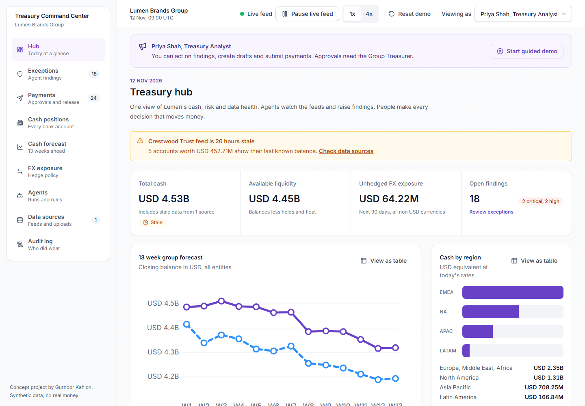
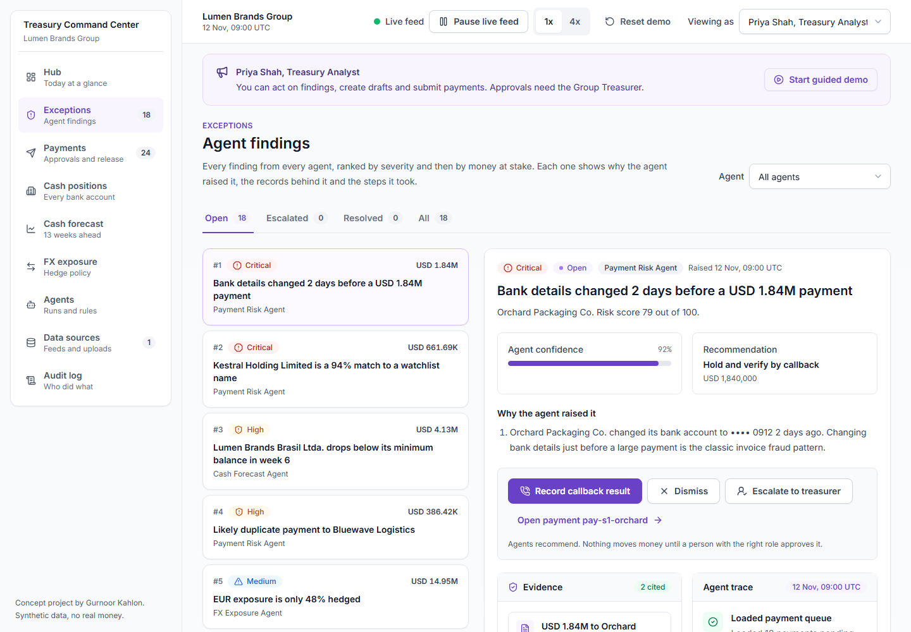
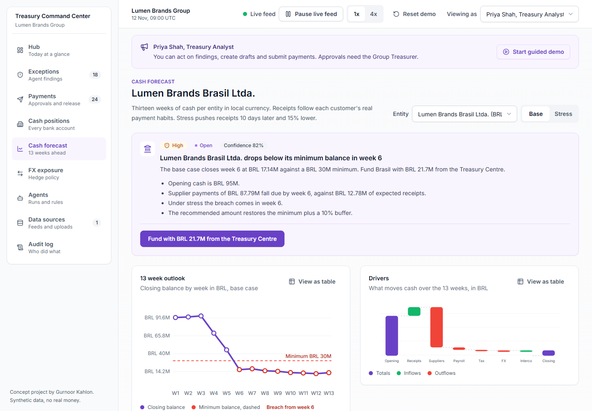
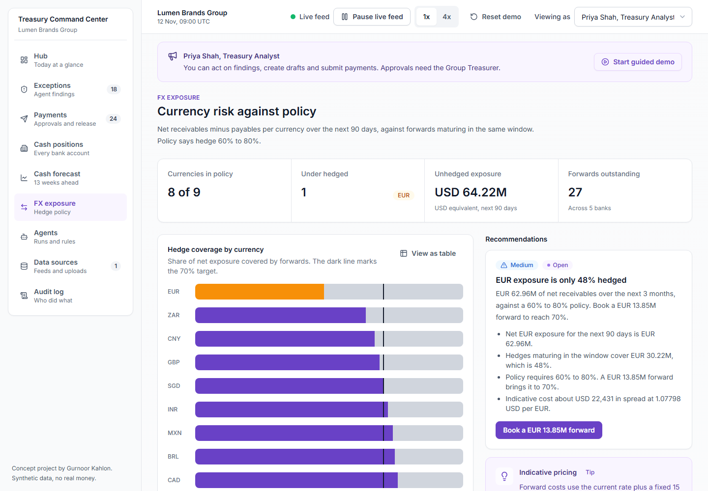

# Treasury Command Center

A working concept of a corporate treasury hub for a global consumer goods company. Bank feeds, ERP data, FX rates and file uploads flow into one place. Four agents watch the data, flag risk and recommend actions. People approve. Everything is audited.

**Live demo:** https://gurneyk.github.io/TCC/

By Gurnoor Kahlon. Built with the Design System and Claude Code.

> Concept project. All companies, banks, people and data are fictional. It's inspired by the kind of tooling a global CPG treasury team uses, and contains nothing from any employer.



## The problem

A group treasury team runs cash for a dozen entities across five banks. Every morning they piece the picture together from bank portals, an ERP extract and a rates screen. Three things go wrong:

1. **They can't tell which numbers to trust.** A bank feed that silently stopped yesterday still shows a balance.
2. **Risk hides in volume.** One fraudulent bank detail change sits among hundreds of routine payments.
3. **Automation feels unsafe.** Nobody wants a bot that moves money, and auditors need to know who decided what.

## Who it's for

| Persona | Role | What they do in the hub |
|---|---|---|
| Priya Shah | Treasury Analyst | Works the exceptions queue, records callbacks, creates and submits payments |
| Daniel Okafor | Group Treasurer | Approves, rejects and releases payments, books hedges |
| Mei Lin | Internal Auditor | Reads everything, changes nothing, exports the trail |

Switch between them with **Viewing as** in the top bar.

## Try the 2 minute story

Press **Start guided demo** on the hub, or walk it yourself:

1. **Hub.** About 4.5 billion USD across 12 entities and 5 banks. Crestwood Trust is 26 hours stale, so every number built on it carries a Stale badge.
2. **Exceptions.** The top finding: Orchard Packaging changed its bank details two days before a 1.84M payment. Open the evidence and the trace.
3. **Maker and checker.** As Priya, record the callback as not confirmed. The payment rejects itself. As Daniel, the approve button was never available, and the reason is shown next to it.
4. **Reconciliation.** Brightmart short paid by 4.6%. The agent proposes a partial match and a deduction case.
5. **Forecast.** Brazil drops under its minimum in week 6. Accept the recommendation and it becomes a draft funding payment for Daniel.
6. **Audit.** As Mei, filter today's log. Every agent finding and every human decision.



## The agents

Each agent is a pure function: `(snapshot, now) => AgentRun`. Same data in, same findings out. Each finding carries plain language reasons, evidence records, a confidence score and a trace of the steps the agent took.

| Agent | Watches | Example finding |
|---|---|---|
| Payment Risk | Payments waiting for approval | Bank details changed 2 days ago, critical, hold and verify by callback |
| Reconciliation | Unmatched bank lines vs open invoices | 107 lines matched, 3 short pays with deduction cases, 14 bank fees, 8 exceptions |
| Cash Forecast | 13 weeks of cash per entity, base and stress | Brazil breaches its minimum in week 6, fund it with an exact BRL amount |
| FX Exposure | 90 day net exposure vs forwards | EUR only 48% hedged against a 60% to 80% policy, book a forward to reach 70% |

Agents never move money. Accepting a recommendation creates a draft, a hedge request or a confirmed match. A person with the right role does the rest.

## Bank grade patterns

* **Maker and checker.** Analysts submit, the treasurer approves, nobody approves their own payment. The same rule applies to hedge requests.
* **Blocking findings.** A payment with an open high or critical finding can't be approved. The disabled button always shows why.
* **Callback verification.** Bank detail changes need a callback to the number on file. "Not confirmed" rejects the payment automatically.
* **Audit trail.** Every state change writes an event with actor, time, action, target and details. Every payment and finding shows its own timeline. The log exports to CSV.
* **Data freshness.** Each source has an SLA. Miss it and every dependent number is marked stale until someone retries the sync or uploads a statement.
* **Money as integers.** Every amount is integer minor units plus an ISO currency code. No float math on money.



## Accessibility

WCAG 2.2 AA was a requirement from the first screen, not polish at the end.

* Skip link, landmarks, one `h1` per route, a unique page title, and focus moves to the heading on navigation.
* Drawers and modals trap focus, close on Escape and return focus to whatever opened them. Stacked dialogs only react to the top one.
* Every chart has `role="img"` with a label that states the takeaway, plus a **View as table** toggle with the same data in a real table.
* Severity and status always have a text label and an icon, never color alone.
* One polite live region announces only new high or critical findings, at most once every 10 seconds. The live feed never spams screen readers.
* `prefers-reduced-motion` is respected.
* Playwright runs axe on all 9 routes with zero serious or critical violations.

## How the Design System was used and extended

Every screen is built from the [Design System](https://github.com/GurneyK/Design-library). No raw hex values, no new tokens. Components came in through `scripts/ds-add.sh`, which never overwrites a file that was already promoted.

Many Design System components were demos with hardcoded data. 25 were promoted with typed props, keeping the old data as defaults so they still render the same with no props. Several picked up accessibility fixes along the way: focus trapping, keyboard rows, a visible focus outline and contrast fixes. Each one is logged in [docs/DS_CHANGES.md](docs/DS_CHANGES.md), ready to upstream. Patterns that might deserve a place in the Design System are proposed in [docs/DS_GAPS.md](docs/DS_GAPS.md).



## Under the hood

* Vite, React 18, TypeScript strict, Tailwind 3 with the Design System tokens, zustand, react-router (hash router for GitHub Pages).
* A seeded generator builds the whole world: 12 entities, 29 accounts, about 1,300 invoices, a year of bank history and 8 planted scenarios (S1 to S8) that always exist.
* A live feed pushes bank lines every 4 seconds, nudges FX every 15 and reruns reconciliation every 30. It uses the same seeded RNG, so a reset replays the same sequence.
* User actions persist to `localStorage` as a small overlay on top of the seeded data. Refresh mid demo and you're where you left off. **Reset demo** clears it.
* The CSV statement upload parses in the browser. Try it with [the sample statement](public/samples/crestwood-statement.csv).

## Run it

```bash
npm install
npm run dev        # http://localhost:5173/TCC/
npm run test       # unit and store tests, 34 of them
npm run build      # typecheck and production build
npm run test:e2e   # Playwright and axe against the production build
npm run lint
```

The Design System lives next to this repo at `../Design-library`. It's only needed to copy in more components.

## Docs

* [Build spec](docs/BUILD_SPEC.md): product, data, agents, screens and phases
* [Progress](docs/PROGRESS.md): what's done, what's skipped, open questions
* [Design System changes](docs/DS_CHANGES.md) and [gaps](docs/DS_GAPS.md)
* [CLAUDE.md](CLAUDE.md): the rules Claude Code follows in this repo
